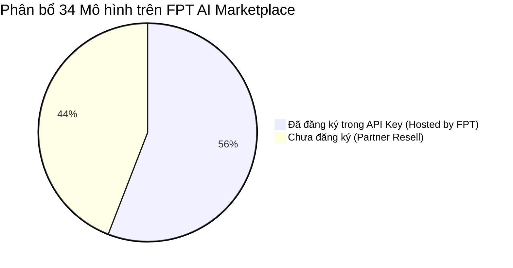

# Báo Cáo So Sánh Quyền Hạn API Key & Danh Mục Mô Hình FPT AI Marketplace

> **Tài liệu đối soát quyền hạn API Key thực tế và danh mục mô hình FPT AI Catalog**  
> Tham chiếu dữ liệu: [fpt-ai-list-model.json](file:///c:/Users/Admin/Documents/2.%20locnv/platform-makvid-studio/docs/fpt.ai/fpt-ai-list-model.json) & Ảnh cấu hình API Key thực tế của người dùng.

---

## 1. Tổng Quan Kết Quả So Sánh

Khi đối chiếu giữa ảnh chụp giao diện cấp quyền API Key (**Create an API Key - Permission**) với danh mục toàn bộ **34 mô hình sản xuất** trong tệp [fpt-ai-list-model.json](file:///c:/Users/Admin/Documents/2.%20locnv/platform-makvid-studio/docs/fpt.ai/fpt-ai-list-model.json):

- **Tổng số mô hình trên Marketplace**: **34 mô hình**.
- **Số mô hình ĐÃ ĐĂNG KÝ (Đã chọn trong API Key)**: **19 mô hình** (chiếm 55.9%).
  - Toàn bộ 19 mô hình này thuộc nhóm **Hosted by FPT** (vận hành trực tiếp trên hạ tầng GPU NVIDIA H100/H200 của FPT AI Factory tại Việt Nam và Nhật Bản).
- **Số mô hình CHƯA ĐĂNG KÝ (Chưa có trong API Key)**: **15 mô hình** (chiếm 44.1%).
  - Toàn bộ 15 mô hình này thuộc nhóm **Partner Resell** (mô hình phân phối lại từ các đối tác toàn cầu: Google, OpenAI qua Azure, Alibaba Cloud, Z.ai/Zhipu, Moonshot Kimi, MiniMax).

---

## 2. Danh Sách 15 Mô Hình CHƯA ĐĂNG KÝ Trong API Key

Toàn bộ các mô hình dưới đây có mặt trong danh mục chính thức [fpt-ai-list-model.json](file:///c:/Users/Admin/Documents/2.%20locnv/platform-makvid-studio/docs/fpt.ai/fpt-ai-list-model.json) nhưng **chưa xuất hiện trong hộp thoại cấp quyền API Key hiện tại**:

| STT | Tên hiển thị (Model Name) | Mã định danh API (`code`) | Nhà cung cấp gốc (Provider) | Phân loại (Category) | Ngữ cảnh (Context) | Max Output | Bảng giá Token per 1M (Cached / In / Out) |
| :---: | :--- | :--- | :---: | :---: | :---: | :---: | :--- |
| **1** | **Google:Gemini-3.5-Flash** | `gemini-3.5-flash-resell` | Google | Vision Language Model | 1,000,000 (1M) | 65,536 | Cached: \$0.15 / In: \$1.50 / Out: \$9.00 |
| **2** | **Google:Gemini-3.1-Pro-Preview-Custom-Tool** | `gemini-3.1-pro-preview-custom-tool-resell` | Google | Vision Language Model | 1,048,576 (1.04M) | 65,536 | Cached: \$0.02 / In: \$2.00 / Out: \$12.00 |
| **3** | **Azure:gpt-5.6-sol** | `gpt-5.6-sol-resell` | Open.AI (Azure) | Large Language Model | 1,050,000 (1.05M) | 128,000 | Cached: \$0.50 / In: \$5.00 / Out: \$30.00 |
| **4** | **Azure:gpt-5.6-terra** | `gpt-5.6-terra-resell` | Open.AI (Azure) | Large Language Model | 1,050,000 (1.05M) | 128,000 | Cached: \$0.20 / In: \$2.00 / Out: \$12.00 |
| **5** | **Azure:gpt-5.6-luna** | `gpt-5.6-luna-resell` | Open.AI (Azure) | Large Language Model | 1,050,000 (1.05M) | 128,000 | Cached: \$0.02 / In: \$0.20 / Out: \$1.20 |
| **6** | **Azure:gpt-4.1-nano** | `gpt-4.1-nano-resell` | Open.AI (Azure) | Large Language Model | 1,047,576 (1.04M) | 32,768 | Cached: \$0.03 / In: \$0.10 / Out: \$0.40 |
| **7** | **Alibaba:DeepSeek-V4.1-Flash** | `deepseek-v4.1-flash-resell` | DeepSeek (Alibaba) | Large Language Model | 1,048,576 (1.04M) | 393,216 | Cached: \$0.03 / In: \$0.30 / Out: \$1.20 |
| **8** | **Alibaba:Deepseek-V4-Pro-0813** | `deepseek-v4-pro-0813-resell` | DeepSeek (Alibaba) | Large Language Model | 1,000,000 (1M) | 393,216 | Cached: \$0.132 / In: \$1.32 / Out: \$3.96 |
| **9** | **Alibaba:Qwen3.8-Max** | `qwen3.8-max-resell` | Qwen (Alibaba) | Vision Language Model | 1,000,000 (1M) | 131,072 | Cached: \$0.25 / In: \$2.00 / Out: \$6.00 |
| **10** | **Alibaba:Qwen3.8-Omni-Flash** | `qwen3.8-omni-flash-resell` | Qwen (Alibaba) | Vision Language Model | 1,000,000 (1M) | 131,072 | Cached: \$0.016 / In: \$0.15 / Out: \$0.47 |
| **11** | **Alibaba:Kimi-K3** | `kimi-k3-resell` | Moonshot (Alibaba) | Large Language Model | 1,048,576 (1.04M) | 131,072 | Cached: \$0.30 / In: \$3.00 / Out: \$15.00 |
| **12** | **Z.ai:GLM-5.3** | `glm-5.3-resell` | Z.ai (Zhipu AI) | Large Language Model | 1,000,000 (1M) | 128,000 | Cached: \$0.26 / In: \$1.40 / Out: \$4.40 |
| **13** | **Z.ai:GLM-5.3-Flash** | `glm-5.3-flash-resell` | Z.ai (Zhipu AI) | Large Language Model | 1,000,000 (1M) | 131,072 | Cached: \$0.03 / In: \$0.15 / Out: \$0.50 |
| **14** | **Z.ai:GLM-5.2** | `glm-5.2-resell` | Z.ai (Zhipu AI) | Large Language Model | 1,000,000 (1M) | 131,072 | Cached: \$0.26 / In: \$1.40 / Out: \$4.40 |
| **15** | **Minimax:Minimax-M3** | `minimax-m3-resell` | MiniMax | Vision Language Model | 1,048,576 (1.04M) | 512,048 | Cached: \$0.06 / In: \$0.30 / Out: \$1.20 |

---

## 3. Phân Tích Chi Tiết 15 Mô Hình Chưa Đăng Ký Theo Nhóm

### 3.1. Nhóm Google Gemini (2 mô hình VLM)
- **`gemini-3.5-flash-resell` (Google:Gemini-3.5-Flash)**:
  - *Đặc điểm*: Cửa sổ ngữ cảnh 1M token, tốc độ xử lý đa phương tiện vượt trội.
  - *Ứng dụng Makvid Studio*: Đọc toàn bộ tài liệu dự án kèm theo nhiều hình ảnh phóng sự, nhận diện storyboard tự động từ video gốc.
- **`gemini-3.1-pro-preview-custom-tool-resell` (Google:Gemini-3.1-Pro-Preview-Custom-Tool)**:
  - *Đặc điểm*: Hỗ trợ sâu function calling / custom tools mở rộng. Tối ưu cho kịch bản điều khiển pipeline tự động hóa.

### 3.2. Nhóm OpenAI qua Microsoft Azure (4 mô hình LLM)
- **`gpt-5.6-sol-resell` (Azure:gpt-5.6-sol)**:
  - *Đặc điểm*: Flagship model thế hệ mới nhất của OpenAI. Khả năng tư duy logic và sáng tạo kịch bản điện ảnh ở cấp độ tinh hoa.
  - *Chi phí*: \$5.00 In / \$30.00 Out per 1M token (cao nhất danh mục).
- **`gpt-5.6-terra-resell` (Azure:gpt-5.6-terra)**:
  - *Đặc điểm*: Model cân bằng giữa hiệu năng phân tích chuyên sâu và chi phí (\$2.00 In / \$12.00 Out).
- **`gpt-5.6-luna-resell` (Azure:gpt-5.6-luna)**:
  - *Đặc điểm*: Biến thể siêu tiết kiệm của dòng GPT-5.6 (\$0.20 In / \$1.20 Out), phù hợp sinh hàng loạt tiêu đề, hook và tóm tắt.
- **`gpt-4.1-nano-resell` (Azure:gpt-4.1-nano)**:
  - *Đặc điểm*: Tối ưu siêu tốc với chi phí rẻ (\$0.10 In / \$0.40 Out), phù hợp làm bước phân loại thể loại nội dung.

### 3.3. Nhóm Alibaba Cloud & Partner Resell (5 mô hình)
- **`deepseek-v4.1-flash-resell` & `deepseek-v4-pro-0813-resell`**:
  - *Lưu ý quan trọng*: Khác với bản `deepseek-v4.1-flash` (Hosted by FPT tại Nhật Bản), bản có đuôi `-resell` được FPT định tuyến thông qua hạ tầng của Alibaba Cloud tại khu vực Việt Nam.
- **`qwen3.8-max-resell` & `qwen3.8-omni-flash-resell`**:
  - *Đặc điểm*: Dòng mô hình Omni đa phương tiện mới nhất của Qwen với khả năng phân tích âm thanh, hình ảnh và văn bản thời gian thực.
- **`kimi-k3-resell` (Alibaba:Kimi-K3)**:
  - *Đặc điểm*: Mô hình của Moonshot AI nổi tiếng với khả năng đọc và tóm tắt tài liệu văn bản siêu dài không bị mất ngữ cảnh (Context 1.048M).

### 3.4. Nhóm Zhipu AI / Z.ai Resell (3 mô hình)
- **`glm-5.3-resell` & `glm-5.3-flash-resell`**:
  - *Đặc điểm*: Thế hệ nâng cấp của GLM-5.2 với khả năng suy luận đa ngôn ngữ (đặc biệt là tiếng Trung và tiếng Anh, kết hợp dịch thuật chuẩn xác sang tiếng Việt).
- **`glm-5.2-resell`**:
  - *Đặc điểm*: Bản phân phối Resell đối tác của GLM-5.2 (song song với bản `fci-glm-5-2` Hosted by FPT).

### 3.5. Nhóm MiniMax (1 mô hình)
- **`minimax-m3-resell` (Minimax:Minimax-M3)**:
  - *Đặc điểm*: Nổi bật với Max Output tokens lên đến **512,048 tokens** (cao nhất trong toàn bộ 34 mô hình). Tối ưu cho việc tạo series kịch bản dài tập hoặc giáo trình nhiều chương.

---

## 4. Danh Sách 19 Mô Hình ĐÃ ĐĂNG KÝ Trong API Key Của Bạn

Để tiện đối chiếu, dưới đây là danh sách 19 mô hình bạn đã tích chọn trong hộp thoại tạo API Key:

| STT | Tên hiển thị trên Dialog | Mã kỹ thuật gọi qua API | Hạ tầng | Trạng thái tích hợp trong Makvid Studio |
| :---: | :--- | :--- | :---: | :--- |
| 1 | **Qwen3.8-27B** | `qwen3.8-27b-fp8` | Hosted by FPT | Khả dụng qua Gateway |
| 2 | **GLM-5.2** | `fci-glm-5-2` | Hosted by FPT | Khả dụng qua Gateway |
| 3 | **DeepSeek-V4-Flash** | `deepseek-v4-flash` | Hosted by FPT | Khả dụng qua Gateway |
| 4 | **DeepSeek-V4.1-Flash** | `deepseek-v4.1-flash` | Hosted by FPT | Đang kích hoạt hạ tầng JP |
| 5 | **gemma-4-31B-it** | `gemma-4-31b-it` | Hosted by FPT | **Khả dụng & Khuyên dùng** |
| 6 | **Saola-Small-32B** | `Saola-Small-32B` | Hosted by FPT | **Mô hình chính (Mặc định)** |
| 7 | **Quyet-1.0-Large** | `quyet-1.0-large` | Hosted by FPT | Khả dụng cho System One |
| 8 | **FPT.TTS-ultra** | `fpt-tts-ultra` | Hosted by FPT | Module Lồng tiếng chất lượng cao |
| 9 | **bge-reranker-v2-m3** | `bge-reranker-v2-m3` | Hosted by FPT | Module Tìm kiếm & Xếp hạng RAG |
| 10 | **Vietnamese_Embedding** | `vietnamese-embedding` | Hosted by FPT | Module Vector hóa tiếng Việt |
| 11 | **FPT.AI-VITs** | `fpt-ai-vits` | Hosted by FPT | Module Lồng tiếng 9 vùng miền |
| 12 | **multilingual-e5-large** | `multilingual-e5-large` | Hosted by FPT | Module Vector hóa đa ngôn ngữ |
| 13 | **FPT.TTS-pro** | `fpt-tts-pro` | Hosted by FPT | Module Lồng tiếng 5 giọng chuẩn |
| 14 | **Qwen2.5-VL-7B-Instruct** | `Qwen2.5-VL-7B-Instruct` | Hosted by FPT | **Khả dụng (VLM - Đọc ảnh)** |
| 15 | **Qwen3.6-27B** | `Qwen3.6-27B` | Hosted by FPT | **Khả dụng & Tốc độ cao** |
| 16 | **gpt-oss-120b** | `gpt-oss-120b` | Hosted by FPT | **Khả dụng (OpenAI 120B MoE)** |
| 17 | **gemma-4-26B-A4B-it** | `gemma-4-26B-A4B-it` | Hosted by FPT | Khả dụng qua Gateway |
| 18 | **Llama-3.3-70B-Instruct** | `Llama-3.3-70B-Instruct` | Hosted by FPT | **Khả dụng (Meta 70B - Rất mạnh)** |
| 19 | **gemma-3-27b-it** | `gemma-3-27b-it` | Hosted by FPT | Khả dụng qua Gateway |

---

## 5. Tại Sao 15 Mô Hình Trên Chưa Xuất Hiện Trong Hộp Thoại API Key?

> [!NOTE] Cơ chế phân loại tài khoản của FPT Cloud AI Marketplace
> 1. **Gói tài khoản FPT Native (Serverless GPU)**: Cho phép API Key truy cập ngay vào 19 mô hình chạy trực tiếp trên hạ tầng cụm GPU của FPT (Hosted by FPT).
> 2. **Gói Partner Resell (Topup Credit Resell)**: 15 mô hình có đuôi `-resell` yêu cầu tài khoản phải bật gói **Topup Credit Resell** (thanh toán trả trước theo hạn mức USD đối tác như Azure, Google, Alibaba).
> 3. Khi tài khoản chưa nạp Credit Resell hoặc chưa liên kết hạn mức đối tác, giao diện tạo API Key sẽ chỉ hiển thị danh sách 19 mô hình nội bộ FPT để tránh phát sinh lỗi không đủ số dư.

### Hướng dẫn kích hoạt 15 mô hình Partner Resell (nếu có nhu cầu):
1. Đăng nhập vào [FPT Cloud Marketplace Console](https://marketplace.fptcloud.com/en).
2. Vào mục **Billing / Credit Balance** ➔ Chọn **Topup Resell Credit**.
3. Sau khi số dư Resell khả dụng, mở lại trang **API Keys** ➔ Tạo key mới hoặc chỉnh sửa key hiện tại, danh sách 15 mô hình đối tác (`*-resell`) sẽ hiển thị để bạn chọn thêm.
4. Đối với dự án **Makvid Studio**, hiện tại **19 mô hình Hosted by FPT** (đặc biệt là `Saola-Small-32B`, `Llama-3.3-70B-Instruct`, `Qwen3.6-27B`, `gpt-oss-120b`) đã hoàn toàn đáp ứng trọn vẹn mọi tác vụ sinh kịch bản video, phân cảnh và lồng tiếng TTS với độ trễ thấp nhất và tối ưu chi phí tối đa.

